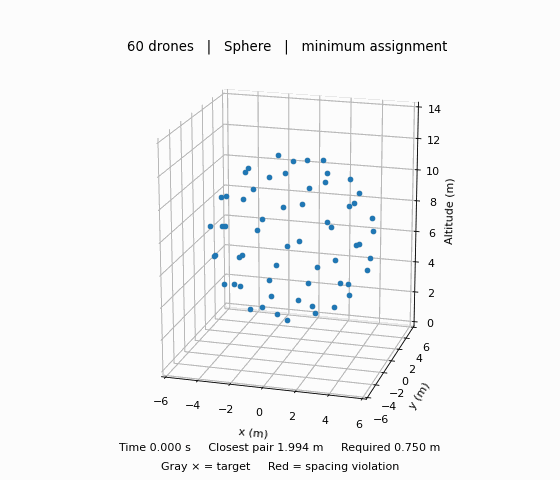

# Drone Swarm Formation Control and Collision Avoidance

A CS 6376 project with Dr. Karsai exploring formation transitions, target
assignment, and trajectory tracking for simulated drone swarms.

The current 3D experiment moves 60 drones through **sphere → grid → double helix**.
A simplified point model generates reference motion. A separate experiment uses
Crazyflie quadrotors in PyBullet to track that motion.



## Install and run

The point-model demos require Python 3.9 or newer. From the repository root:

```bash
python -m venv .venv
source .venv/bin/activate
python -m pip install -e .
python -m drone_swarm.demo3d
```

Drag the 3D plot to rotate it. Other commands:

```bash
python -m drone_swarm.demo3d --shape heart
python -m drone_swarm.demo3d --assignment index
mkdir -p outputs
python -m drone_swarm.demo3d --gif outputs/show.gif
```

The 3D demo defaults to sphere → grid → double helix with 60 drones.
Index matching assigns targets in array order. Minimum matching minimizes the
sum of drone-to-target Euclidean distances using SciPy's modified
Jonker–Volgenant assignment implementation.

## Quadrotor physics

The optional physics dependency requires Python 3.12. On macOS, install Apple's
command-line build tools before building PyBullet. Create the environment once:

```bash
conda create -n swarm-physics python=3.12 pip -y
conda activate swarm-physics
CFLAGS="-Dfdopen=fdopen" python -m pip install --no-cache-dir pybullet
python -m pip install -e ".[physics]"
```

If you already installed the physics dependencies in this environment, install
just this project's package with `python -m pip install -e .`.

```bash
python -m drone_swarm.physics_demo --gui
python -m drone_swarm.physics_swarm --gui
```

Omit `--gui` for headless execution. The swarm run initializes drones in the
sphere at altitude and then follows the reference schedule. Each drone receives
desired positions and velocities at 48 Hz. Its own built-in PID controller
computes four motor RPM commands. PyBullet advances the dynamics at 240 Hz.
Loading and simulation can take longer than the simulated flight duration.

The physics integration uses the open-source
[gym-pybullet-drones](https://github.com/learnsyslab/gym-pybullet-drones)
package, its `CtrlAviary` environment, `DroneModel.CF2X` model, and
`DSLPIDControl` controller. The optional dependency is pinned to the installed
upstream commit in `pyproject.toml`. It supplies vehicle parameters, motor thrust
and torque calculations, and the flight controller. PyBullet supplies rigid-body
integration and the GUI. The current physics mode uses gravity, thrust, torque,
and contact dynamics. Optional aerodynamic drag, ground effect, and downwash
models are disabled.

## Mathematical model and measurements

The reference model uses position p, velocity v, and commanded acceleration u:

```text
p_dot = v
v_dot = u
u = norm_limit((target - p) - 2v, 2 m/s²)
```

Semi-implicit Euler updates velocity before position at a 0.050 s timestep.
Total speed is limited to 2.000 m/s and acceleration to 2.000 m/s².

Reference-model arrival requires every drone's position error ≤ 0.100 m and
speed ≤ 0.100 m/s for consecutive samples spanning 0.500 s. Each arrival is
followed by a 1.000 s controlled hold. Position and velocity carry through
formation transitions. The PyBullet experiment follows this reference schedule
and reports final position errors. It does not independently wait for actual
quadrotor settling.

The detector checks each unique pair's closest approach along the straight
segment between consecutive samples. One contiguous episode below 0.750 m
counts as one spacing violation for that pair. These are center-spacing
measurements. Physical contact counts are not collected. Animation highlights
use separation at displayed frames.

Observed results for the minimum-distance assignment:

| Transition | Reference episodes | PyBullet episodes | PyBullet minimum separation | PyBullet worst final error |
|---|---:|---:|---:|---:|
| Sphere → grid | 0 | 0 | 1.497 m | 0.029 m |
| Grid → double helix | 7 | 5 | 0.640 m | 0.033 m |

The helix has two opposite slots at each of 30 heights. Each strand makes two
turns around a 2.000 m radius over 5.000 m of height. Its minimum final slot
spacing is 0.877 m. This geometry was selected after trying several layouts as
a transition stress case. These results describe that selected experiment.

## Repository layout

| Path | Purpose |
|---|---|
| `drone_swarm/model.py` | Point dynamics, PD tracking, and motion limits |
| `drone_swarm/planner.py` | 3D formations and target assignment |
| `drone_swarm/simulation.py` | Reference simulation and measurements |
| `drone_swarm/demo3d.py` | 3D reference animation |
| `drone_swarm/physics_demo.py` | Single-quadrotor hover and movement demo |
| `drone_swarm/physics_swarm.py` | 60-quadrotor reference tracking experiment |
| `tests/` | Automated baseline checks |
| `docs/assets/` | Existing plots and animation |
| `outputs/` | Suggested location for generated files, ignored by Git |

After editable installation, you can also use the commands `swarm-3d`,
`swarm-physics-demo`, and `swarm-physics`.

## Verification

```bash
python -m unittest discover -s tests -v
python -m drone_swarm.physics_swarm
```

The six baseline tests check crossing detection, episode counting, equilibrium,
motion limits, assignments, arrival, and the 3D helix transition at two timesteps.
Physics verification is a separate headless integration run.

## Remaining work

- Add collision-aware centralized trajectory planning.
- Compare it with direct target tracking across multiple transitions.
- Verify actual quadrotor settling and tracking error throughout the motion.
- Evaluate safety, completion time, total travel, and planning cost.

## Initialize Git and push

Run these commands from the repository root after reviewing the files:

```bash
git init -b main
git add .
git status
git commit -m "Initial drone swarm simulation"
```

Create an empty GitHub repository, then use its URL:

```bash
git remote add origin https://github.com/YOUR_USERNAME/drone-swarm.git
git push -u origin main
```
